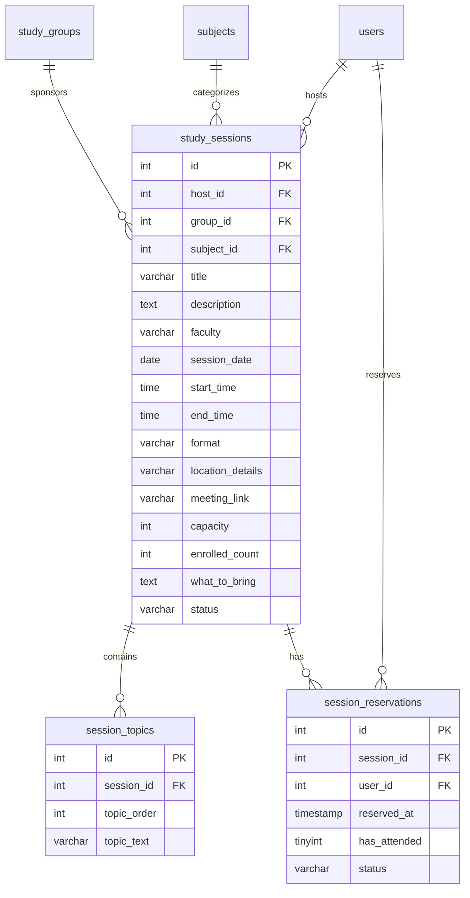
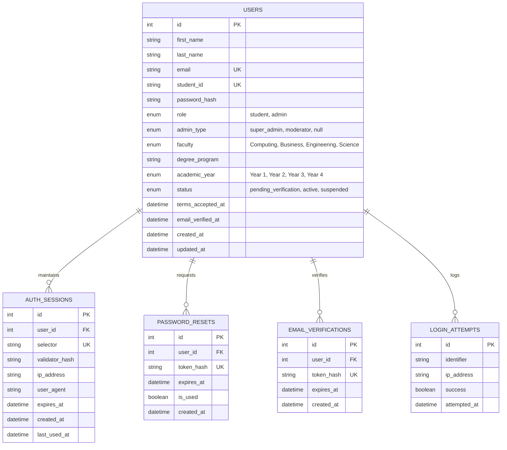

# 🏛️ NSBM STUDY CIRCLE – CENTRAL BACKEND SPECIFICATION & REQUIREMENTS DOCUMENT

> **Document Version:** 2.0  
> **Target Database:** MySQL / MariaDB (`nsbm_student_circle`)  
> **Backend Stack:** PHP 8.2+ (RESTful API / PDO & Prepared Statements) · JSON AJAX  
> **Status:** Requirements & Architectural Specification (Implementation Phase to follow across all completed modules)

---

## 1. Executive Summary & Unified Platform Architecture

NSBM Study Circle is an integrated university learning management and student peer collaboration platform. The platform operates on a single centralized relational MySQL database (`nsbm_student_circle`) powering all platform modules:

1. **Authentication & RBAC:** Student portal and multi-tier Admin consoles (Super Admin, Content Moderator, Community Moderator).
2. **Academic Directory & Resource Library:** Modules, revision guides, past papers, notes, download tracking, and student ratings.
3. **Student Knowledge Exchange (Discussions):** Question forum, verified student answers, peer helpful voting, nested replies, solution acceptance, and moderation.
4. **Learning Communities (Study Groups):** Focused subject circles, weekly schedules, activity feeds, peer coordinators, session integrations, and membership management.
5. **Study Sessions:** Scheduled exam reviews, live problem walkthroughs, seat reservations, and online/physical meeting logistics.
6. **Support & Inquiries:** Knowledge base, FAQ search, and student inquiry messaging.

---

## 2. Module Analysis: Study Groups & Learning Communities System

*(Analysis based on Figma / Reference Screenshots Pages 1 to 12)*

### 2.1 All Dynamic Data Required by the Pages

#### A. Main Study Groups Directory Page (`frontend/study-groups.php` / `.html`)
1. **User Session Context:**
   - Authenticated User ID (`$_SESSION['user_id']`), Full Name, Avatar initials, Role (`student` / `admin`).
   - Guest vs Logged-in navigation states (Login/Join buttons vs Dashboard/Logout buttons).
2. **Hero Metrics & Counters:**
   - Total active community count (e.g. `7 communities found`).
3. **Search & Filter States:**
   - Active faculty / subject filter pill (`All`, `Computing`, `Business`, `Engineering`, `Science`).
   - Debounced query parameter (`q=...`).
4. **Featured Community Banner Card:**
   - Featured Group ID (Primary Key).
   - Group Code (e.g., `DS`, `BM`, `EI`, `SC`, `AI`, `FN`, `RS`).
   - Group Name (`Data Structures Circle`).
   - Badge styling classes (background color, text color, accent classes).
   - Summary description.
   - Total enrolled member count (e.g. `48 members`).
   - Recurring meeting schedule string (e.g. `Meets Wednesdays`).
   - Active status string (`Active this week`).
5. **Community Cards Grid (Paginated / Filtered List):**
   - Unique Group ID (`id`).
   - Category / Faculty name.
   - 2-letter Badge Initials & custom badge color tokens (`badge-ds`, `badge-bm`, `badge-ei`, etc.).
   - Card Title & Short Description.
   - Real-time active indicator dot (`• Active this week`).
   - Member Avatar Stack data:
     - 2 leading active student initials (e.g. `NP`, `KS`).
     - Overflow member counter (`+N`, calculated dynamically as `member_count - 2`).
     - Total member count (`48 members`).
   - Direct link to group detail view (`study-group-details.php?id={id}`).

#### B. Individual Study Group Details Page (`frontend/study-group-details.php` / `.html`)
1. **Hero Header:**
   - Group Code initials badge (`DS`).
   - Group Full Title (`Data Structures Circle`).
   - Short tagline description.
   - Total Member count with live join/leave synchronization.
   - Formatted founding date (e.g., `Created February 2025`).
   - Current viewer's membership status (`is_member: true | false`).
2. **About This Group Section:**
   - Full Markdown/Text description detailing circle goals, weekly objectives, and conduct.
   - `What we study` subject topic tags (parsed list: `Arrays & linked lists`, `Trees`, `Graphs`, `Sorting`, `Complexity`).
3. **Recent Activity Feed (Chronological Stream):**
   - Activity ID.
   - Student Author Name (`Nethmi Perera`, `Kavindu Silva`, `Amaya`).
   - Author Avatar Initials circle (`NP`, `KS`, `AF`).
   - Action Verb / Text (`shared a revision checklist`, `asked about AVL rotations`, `scheduled a graph traversal session`).
   - Human-readable relative timestamp (`35 minutes ago`, `2 hours ago`, `Yesterday`).
   - Context target link (redirects to linked discussion, resource download, or session page).
4. **Sidebar: Next Group Session:**
   - Session ID.
   - Bold calendar day number (`24`).
   - Calendar month abbreviation (`MAY`).
   - Scheduled Session Title (`Graph Traversal Practice`).
   - Meeting timing & format (`Saturday · 6:30 PM · Online`).
   - Enrollment capacity & seat reservation state.
5. **Sidebar: Group Coordinators:**
   - Coordinator list ordered by seniority:
     - Full Name (`Nethmi Perera`, `Sahan Dissanayake`).
     - Dark navy initials circle (`NP`, `SD`).
     - Role designation (`Coordinator`, `Founder & Coordinator`).
6. **Sidebar: Community Standards Notice:**
   - Static/Dynamic policy on academic integrity and anti-plagiarism guidance.

#### C. Contact & Help Section (`frontend/contact.php` / `.html` - PDF Pages 6 to 9)
1. **Help Categories:** `Getting started`, `Resources & downloads`, `Groups & sessions`, `Discussions`, `Safety & reporting`.
2. **Interactive FAQ Accordion:** Question titles, expandable HTML answer bodies.
3. **Contact Submission Metadata:** Response time SLA (`Typical response time: 1–2 working days`).

---

### 2.2 All User Actions & Interactions

| Action | Trigger | Expected Frontend Behavior | Required Backend Operation |
| :--- | :--- | :--- | :--- |
| **Search Groups** | Keystroke in `#groupSearchInput` | Filter cards in real time by name, category, or module | AJAX search query or instant DOM filter with server sync |
| **Filter by Category** | Clicking `All`, `Computing`, `Business`, `Engineering`, `Science` | Highlights active pill, smoothly animates grid to show matching cards | Server/client category filter query |
| **View Group Details** | Click **"View group"** on card or featured banner | Navigates to `study-group-details.php?id={id}` | Loads full group payload, coordinator team, next session & feed |
| **Join Study Group** | Click **"Join this group"** on detail page | Button changes to `Joined ✓`, updates member counter | Inserts `study_group_members`, increments `member_count`, logs activity |
| **Leave Study Group** | Click **"Joined (Leave)"** on detail page | Button resets to `Join this group`, decrements counter | Deletes `study_group_members`, decrements `member_count` |
| **Create Study Group** | Submit **"Create a study group"** modal form | Shows loading spinner, shows success toast, redirects | Validates input, generates 2-letter code, inserts `study_groups` & coordinator |
| **View Group Session** | Click **"View session"** in sidebar | Navigates to session reservation page | Fetches session ID and opens booking modal |
| **Activity View Link** | Click **"View"** on an activity item | Navigates to referenced resource/discussion | Resolves target discussion/resource URL |
| **Send Help Message** | Submit **"Send us a message"** form | Shows feedback alert, resets form fields | Inserts inquiry into support messages table, sends notification email |

---

### 2.3 Central Database Tables & Schema Specification

The following tables integrate seamlessly into the `nsbm_student_circle` MySQL database:

#### 1. `study_groups` (Master Groups Table)
```sql
CREATE TABLE IF NOT EXISTS study_groups (
    id INT AUTO_INCREMENT PRIMARY KEY,
    name VARCHAR(120) NOT NULL,
    code VARCHAR(10) NOT NULL DEFAULT 'SG',
    category ENUM('Computing', 'Business', 'Engineering', 'Science') NOT NULL DEFAULT 'Computing',
    is_featured TINYINT(1) NOT NULL DEFAULT 0,
    schedule_info VARCHAR(100) NOT NULL DEFAULT 'Meets Wednesdays',
    activity_status VARCHAR(50) NOT NULL DEFAULT 'Active this week',
    description TEXT NOT NULL,
    about_text TEXT NULL,
    what_we_study VARCHAR(255) NULL,
    created_date_str VARCHAR(50) DEFAULT 'Created February 2025',
    badge_color VARCHAR(30) DEFAULT 'badge-ds',
    creator_id INT NOT NULL,
    member_count INT NOT NULL DEFAULT 1,
    max_members INT NOT NULL DEFAULT 48,
    status ENUM('Active', 'Review', 'Flagged', 'Archived') NOT NULL DEFAULT 'Active',
    reports_count INT NOT NULL DEFAULT 0,
    created_at TIMESTAMP DEFAULT CURRENT_TIMESTAMP,
    updated_at TIMESTAMP DEFAULT CURRENT_TIMESTAMP ON UPDATE CURRENT_TIMESTAMP,
    FOREIGN KEY (creator_id) REFERENCES users(id) ON DELETE CASCADE,
    INDEX idx_category (category),
    INDEX idx_status (status),
    INDEX idx_featured (is_featured)
) ENGINE=InnoDB DEFAULT CHARSET=utf8mb4;
```

#### 2. `study_group_members` (Membership Mapping)
```sql
CREATE TABLE IF NOT EXISTS study_group_members (
    id INT AUTO_INCREMENT PRIMARY KEY,
    group_id INT NOT NULL,
    user_id INT NOT NULL,
    joined_at TIMESTAMP DEFAULT CURRENT_TIMESTAMP,
    UNIQUE KEY uq_group_member (group_id, user_id),
    FOREIGN KEY (group_id) REFERENCES study_groups(id) ON DELETE CASCADE,
    FOREIGN KEY (user_id) REFERENCES users(id) ON DELETE CASCADE,
    INDEX idx_user_groups (user_id)
) ENGINE=InnoDB DEFAULT CHARSET=utf8mb4;
```

#### 3. `study_group_activities` (Activity Feed & Audit Log)
```sql
CREATE TABLE IF NOT EXISTS study_group_activities (
    id INT AUTO_INCREMENT PRIMARY KEY,
    group_id INT NOT NULL,
    user_id INT NULL,
    user_name VARCHAR(100) NOT NULL,
    user_initials VARCHAR(10) NOT NULL,
    action_text VARCHAR(255) NOT NULL,
    relative_time VARCHAR(100) NOT NULL,
    link_url VARCHAR(255) DEFAULT '#',
    created_at TIMESTAMP DEFAULT CURRENT_TIMESTAMP,
    FOREIGN KEY (group_id) REFERENCES study_groups(id) ON DELETE CASCADE,
    FOREIGN KEY (user_id) REFERENCES users(id) ON DELETE SET NULL,
    INDEX idx_group_feed (group_id, created_at DESC)
) ENGINE=InnoDB DEFAULT CHARSET=utf8mb4;
```

#### 4. `study_group_coordinators` (Leadership & Role Mapping)
```sql
CREATE TABLE IF NOT EXISTS study_group_coordinators (
    id INT AUTO_INCREMENT PRIMARY KEY,
    group_id INT NOT NULL,
    user_id INT NULL,
    name VARCHAR(100) NOT NULL,
    initials VARCHAR(10) NOT NULL,
    role_title VARCHAR(100) NOT NULL DEFAULT 'Coordinator',
    created_at TIMESTAMP DEFAULT CURRENT_TIMESTAMP,
    FOREIGN KEY (group_id) REFERENCES study_groups(id) ON DELETE CASCADE,
    FOREIGN KEY (user_id) REFERENCES users(id) ON DELETE SET NULL
) ENGINE=InnoDB DEFAULT CHARSET=utf8mb4;
```

#### 5. `study_sessions` (Calendar & Group Meetups Integration)
```sql
CREATE TABLE IF NOT EXISTS study_sessions (
    id INT AUTO_INCREMENT PRIMARY KEY,
    group_id INT NULL,
    title VARCHAR(200) NOT NULL,
    description TEXT,
    faculty ENUM('Computing', 'Business', 'Engineering', 'Science') DEFAULT 'Computing',
    host_id INT NOT NULL,
    session_date DATETIME NOT NULL,
    location_details VARCHAR(255) NOT NULL,
    capacity INT DEFAULT 24,
    enrolled_count INT DEFAULT 0,
    meeting_link VARCHAR(255) NULL,
    status ENUM('Scheduled', 'Review', 'Completed', 'Cancelled') DEFAULT 'Scheduled',
    created_at TIMESTAMP DEFAULT CURRENT_TIMESTAMP,
    FOREIGN KEY (host_id) REFERENCES users(id) ON DELETE CASCADE,
    FOREIGN KEY (group_id) REFERENCES study_groups(id) ON DELETE SET NULL,
    INDEX idx_session_date (session_date)
) ENGINE=InnoDB DEFAULT CHARSET=utf8mb4;
```

---

### 2.4 Required PHP Backend Endpoints (`study_group_controller.php`)

All API endpoints follow RESTful standards and return consistent JSON structures:

```json
{
  "success": true,
  "message": "Operation successful.",
  "data": {}
}
```

#### 1. List Study Groups
- **Route:** `GET /backend/controllers/study_group_controller.php?action=list`
- **Query Parameters:**
  - `category` *(optional)*: `All` | `Computing` | `Business` | `Engineering` | `Science`
  - `q` *(optional)*: Search query string (title, description, code, topics)
  - `limit` *(optional, default: 30)*: Records per page
- **Response `200 OK`:** Returns `featured` community object, `groups` array with formatted badge color classes and calculated avatar stacks, and `total` count.

#### 2. Get Single Group Details
- **Route:** `GET /backend/controllers/study_group_controller.php?action=get&id={id}`
- **Response `200 OK`:** Returns full group record, parsed `tags`, `is_member` status for current session user, `coordinators` array, `activities` array, and `next_session` object.
- **Error Responses:** `404 Not Found` if invalid ID.

#### 3. Join Study Group
- **Route:** `POST /backend/controllers/study_group_controller.php?action=join`
- **Payload:** `{"id": 1}`
- **Authentication:** Student session required (`$_SESSION['user_id']`).
- **Response `200 OK`:** `{ "success": true, "message": "You have joined the study group!" }`
- **Error Responses:** `401 Unauthorized` if not logged in; `400 Bad Request` if already a member or capacity exceeded.

#### 4. Leave Study Group
- **Route:** `POST /backend/controllers/study_group_controller.php?action=leave`
- **Payload:** `{"id": 1}`
- **Authentication:** Student session required.
- **Response `200 OK`:** `{ "success": true, "message": "You have left the study group." }`
- **Error Responses:** `401 Unauthorized`; `400 Bad Request` if not a member.

#### 5. Create Study Group
- **Route:** `POST /backend/controllers/study_group_controller.php?action=create`
- **Payload:**
  ```json
  {
    "name": "Mobile Application Development Circle",
    "category": "Computing",
    "description": "Cross-platform mobile development using Flutter and React Native.",
    "what_we_study": "Flutter, Dart, State Management, Firebase",
    "about_text": "Weekly coding challenges and code reviews for mobile developers."
  }
  ```
- **Response `201 Created`:** `{ "success": true, "group_id": 8, "message": "Study group created successfully!" }`
- **Error Responses:** `422 Unprocessable Entity` for validation errors.

#### 6. Post Group Activity / Update
- **Route:** `POST /backend/controllers/study_group_controller.php?action=add_activity`
- **Payload:** `{"group_id": 1, "action_text": "shared a revision checklist", "link_url": "resources.php?id=12"}`
- **Response `200 OK`:** `{ "success": true, "activity_id": 4 }`

---

### 2.5 Authentication & Authorization Requirements

1. **Public / Guest Access (Read-Only):**
   - Unauthenticated visitors can view the complete Study Groups directory, search, filter by faculty, and read individual Study Group details, topics, and coordinator information.
   - If a guest clicks **"Join this group"** or **"Create a study group"**, the frontend gracefully directs them to `login.php` with a redirect return parameter (`?redirect=study-groups.php`).

2. **Authenticated Student Access:**
   - Logged-in students can join any open study group, leave a group they currently belong to, submit a new study group for review/creation, and share activity updates in groups they have joined.

3. **Group Coordinator Privileges:**
   - Group creators and appointed coordinators can update group description, topics, and schedule information.
   - Coordinators can create and link upcoming sessions (`study_sessions`) directly to their circle.

4. **Administrator & Moderator Privileges (RBAC):**
   - Super Administrators, Content Moderators, and Community Moderators can feature/unfeature groups (`is_featured = 1`), edit any group's metadata, suspend/flag violating groups (`status = 'Flagged'`), and appoint or remove coordinators.

---

### 2.6 File Upload & Download Requirements

1. **Study Group Custom Avatars & Cover Banners (Future / Coordinator setting):**
   - **Allowed MIME types:** `image/jpeg`, `image/png`, `image/webp`.
   - **Maximum File Size:** `2 MB`.
   - **Destination Directory:** `backend/uploads/groups/`.
   - **Filename Sanitation:** Cryptographic SHA-256 hash prefix (`group_{id}_{hash}.webp`).
2. **Activity Attachments & Revision Guides:**
   - If activities include shared revision guides or checklists:
   - **Allowed MIME types:** `application/pdf`, `application/vnd.openxmlformats-officedocument.wordprocessingml.document`.
   - **Maximum File Size:** `10 MB`.
   - **Virus & Extension Verification:** Strict white-list extension checking and MIME validation via `finfo_file()`.

---

### 2.7 Input Validation & Security Requirements

1. **SQL Injection Defense:**
   - Strict use of PDO / mysqli parameterized prepared statements (`$stmt->bind_param(...)` or PDO placeholders) across all queries, searches, and insertions. No raw variable interpolation in SQL statements.
2. **Cross-Site Scripting (XSS) Prevention:**
   - All dynamic strings (`name`, `description`, `about_text`, `action_text`) are escaped using `htmlspecialchars($str, ENT_QUOTES, 'UTF-8')` before output rendering.
   - Textareas are stripped of malicious script/iframe tags via `strip_tags($input, '<p><br><ul><li><strong><em>')`.
3. **Cross-Site Request Forgery (CSRF) Protection:**
   - POST requests for group creation, membership changes, and message submissions must include a validated session CSRF token (`$_SESSION['csrf_token']`).
4. **Rate Limiting & Abuse Prevention:**
   - Group creation is throttled to a maximum of **3 groups per user per 24-hour window**.
   - Group join/leave actions are rate-limited to prevent automated spamming.
   - Content reporting integration: If a group accumulates 5+ reports (`reports_count >= 5`), its status automatically switches to `Review` pending moderation.
5. **Business Logic Validations:**
   - Group name must be between **5 and 120 characters**.
   - Category must strictly match an allowed whitelist (`Computing`, `Business`, `Engineering`, `Science`).
   - Group membership capacity cannot exceed `max_members` (default: 48).

---

## 3. Module Analysis: Study Sessions & Collaborative Learning System

*(Comprehensive analysis based on Figma / Reference Screenshots Pages 1 – 3, 8 – 11 and frontend files `frontend/sessions.php` / `.html` and `frontend/session-details.php` / `.html`)*

### 3.1 Existing Backend Functionality Discovered
Prior to defining new backend requirements, the existing codebase was thoroughly audited:
1. **Existing Model:** [`backend/models/StudySession.php`](file:///c:/Users/user/Desktop/NSBM%20STUDY%20CIRCLE/backend/models/StudySession.php) already implements `getUpcomingSessions($limit = 3)` with prepared SQL statements on the `study_sessions` table and a fallback data structure used by `home_controller.php`.
2. **Existing Controller Stub:** [`backend/controllers/event_controller.php`](file:///c:/Users/user/Desktop/NSBM%20STUDY%20CIRCLE/backend/controllers/event_controller.php) exists as a placeholder scaffold for session/event operations (`Get all events`, `Create event`, `Register student`).
3. **Existing SQL Schema:** [`backend/database/nsbm_student_circle.sql`](file:///c:/Users/user/Desktop/NSBM%20STUDY%20CIRCLE/backend/database/nsbm_student_circle.sql) contains a base `study_sessions` table (`id`, `title`, `description`, `faculty`, `host_id`, `session_date`, `location_details`, `capacity`, `enrolled_count`, `status`, `created_at`).
4. **Authentication State:** [`backend/controllers/auth_controller.php`](file:///c:/Users/user/Desktop/NSBM%20STUDY%20CIRCLE/backend/controllers/auth_controller.php) manages user login state via standard PHP sessions (`$_SESSION['user_id']`, `$_SESSION['role']`, `$_SESSION['name']`).

---

### 3.2 Session Management Requirements

Based strictly on the interactive elements present in the frontend listing, details page, and modal dialog:

#### Required Data Fields:
| Field Name | Type | Presence in Frontend | Purpose & Business Logic |
| :--- | :--- | :--- | :--- |
| `id` | `INT AUTO_INCREMENT` | URL Param (`?id=1`) | Unique Primary Key for session identification and routing. |
| `title` | `VARCHAR(200)` | Card & Hero Title | Main session topic (e.g., *Algorithms: Final Exam Problem Solving*). Required. |
| `description` | `TEXT` | Detail overview | Detailed session overview describing objectives and target audience. Required. |
| `faculty` / Category | `ENUM` | Pill Badge | Faculty domain: `Computing`, `Business`, `Science`, `Engineering`, `Academic Skills`. Required for filtering. |
| `subject_name` / `subject_id` | `VARCHAR` / `INT` | Dropdown filter | Specific module (e.g. *Programming Fundamentals*, *Financial Accounting*). Linked to `subjects.id`. |
| `host_id` | `INT` (FK) | Host Profile card | References `users.id`. Retrieves host name, role title, and avatar initials. Required. |
| `session_date` | `DATE` | Date Box & Calendar | Date of the session (`2026-05-24`). Used for date sorting, calendar strip highlighting, and week grouping. Required. |
| `start_time` | `TIME` | Meta & Specs row | Scheduled start time (`18:30:00` / `6:30 PM`). Required. |
| `end_time` | `TIME` | Meta & Specs row | Scheduled end time (`20:00:00` / `8:00 PM`). Used to display time range string (`6:30 PM – 8:00 PM`). Required. |
| `format` | `ENUM` | Badge & Meta | Format type: `'Online'` or `'Physical'`. Controls the online tab filter. Required. |
| `location_details` | `VARCHAR(255)` | Meta & Specs row | Public location label: e.g. *Learning Commons Room 3*, *Science Laboratory 2*, or *Online · Meeting link after registration*. Required. |
| `meeting_link` | `VARCHAR(255)` | Booking confirmation | Confidential MS Teams/Zoom URL. **Must only be revealed to confirmed reservations.** |
| `capacity` | `INT` | Capacity spec | Total available places (e.g., `24`). Bounded between 5 and 100. Required. |
| `enrolled_count` | `INT` | Seats status | Real-time reserved seats count. Used to compute *Seats available*, *4 seats left*, or *Session full*. |
| `what_to_bring` | `TEXT` | "What to bring" box | Instructions on textbooks, notes, worksheets, or calculators required. |
| `topics` (Cover list) | `JSON` or 1:N Table | "What we'll cover" | Ordered agenda items with 2-digit sequence badges (`01`, `02`, `03`). |
| `status` | `ENUM` | System status | `'Scheduled'`, `'Review'`, `'Completed'`, `'Cancelled'`. Only `'Scheduled'` is public. |
| `created_at` / `updated_at`| `TIMESTAMP` | System timestamps | Audit tracking for session creation and updates. |

---

### 3.3 Session Listing and Filtering Requirements

The frontend implements three multi-layered filtering mechanisms that the backend must support efficiently:

1. **Tab Filtering (`filter` parameter):**
   * **`upcoming`:** `session_date >= CURDATE() AND status = 'Scheduled' ORDER BY session_date ASC, start_time ASC`
   * **`this-week`:** `YEARWEEK(session_date, 1) = YEARWEEK(CURDATE(), 1) AND status = 'Scheduled'`
   * **`online`:** `format = 'Online' AND session_date >= CURDATE() AND status = 'Scheduled'`

2. **Hierarchical Subject Category Filter (`subject` parameter):**
   * Can accept either an overarching faculty (e.g. `subject=Computing` matching all Computing sessions) or a specific subject name (e.g. `subject=Web Application Development`).
   * When `subject=all`, the category filter is bypassed.

3. **Interactive 7-Day Calendar Strip (`date` parameter):**
   * Clicking a date column (e.g. `SAT 24`, date value `24`) filters sessions where `DAY(session_date) = 24 AND MONTH(session_date) = target_month`.
   * Sessions with active days emit a visual indicator dot on the calendar strip (`cal-active-dot`). The backend can supply an array of active calendar days (`[24, 26, 28, 30]`) for the current viewing week.

4. **Single Session Details Retrieval (`GET ?action=get&id={id}`):**
   * Fetches full session record joined with `users` (host info), `session_topics` (ordered agenda items), count of confirmed reservations, top 3 attendee avatar initials, and current viewer's reservation status (`is_reserved: true|false`).

---

### 3.4 Session Reservations ("Reserve your place") Requirements

The detail page allows students to register for sessions with instant feedback:

1. **Reservation Workflow:**
   * A logged-in student clicks **"Reserve your place"**.
   * Frontend dispatches a `POST` request with `{ "session_id": 1 }` and CSRF token.
   * Backend validates user authentication (`$_SESSION['user_id']`).
   * Backend verifies available seats: `enrolled_count < capacity`.
   * Backend executes an atomic transaction with row locking:
     ```sql
     START TRANSACTION;
     SELECT capacity, enrolled_count FROM study_sessions WHERE id = ? FOR UPDATE;
     -- If enrolled_count >= capacity, ROLLBACK and return 409 Conflict ("Session is full")
     -- Check if duplicate exists:
     SELECT id FROM session_reservations WHERE session_id = ? AND user_id = ?;
     -- If exists, ROLLBACK and return 400 Bad Request ("Already reserved")
     INSERT INTO session_reservations (session_id, user_id, reserved_at) VALUES (?, ?, NOW());
     UPDATE study_sessions SET enrolled_count = enrolled_count + 1 WHERE id = ?;
     COMMIT;
     ```
2. **Duplicate Prevention:**
   * Handled by database constraint: `UNIQUE KEY uq_session_user (session_id, user_id)` and checked in application logic before insertion.
3. **Cancellation Workflow:**
   * If the student has already reserved, the button renders as **"Cancel reservation"** (or student clicks to withdraw).
   * Backend deletes or soft-cancels the reservation row:
     ```sql
     DELETE FROM session_reservations WHERE session_id = ? AND user_id = ?;
     UPDATE study_sessions SET enrolled_count = GREATEST(0, enrolled_count - 1) WHERE id = ?;
     ```
4. **Meeting Link & Calendar Delivery:**
   * Upon successful reservation, response JSON returns `{ "meeting_link": "https://..." }` (for online sessions), and triggers an automated calendar invite (`.ics` attachment) via email.

---

### 3.5 Session Attendance ("Who's attending") Requirements

The frontend displays an attendee avatar stack (`NP`, `KS`, `AF`) and a summary counter: *18 students have reserved a place*.

1. **Student Privacy Protection:**
   * Public API responses must **never** expose student email addresses, full student registration IDs, phone numbers, or academic grades.
   * Only student **First Name + Last Initial** (or avatar initials, e.g. `NP`, `KS`) and public profile photo thumbnail URL may be retrieved.
2. **Avatar Stack Retrieval:**
   * Query limits to the 3 most recently registered attendees for avatar circles:
     ```sql
     SELECT u.name, SUBSTRING_INDEX(u.name, ' ', 1) AS first_name, u.profile_image 
     FROM session_reservations sr
     JOIN users u ON sr.user_id = u.id
     WHERE sr.session_id = ? AND sr.status = 'Confirmed'
     ORDER BY sr.reserved_at DESC
     LIMIT 3;
     ```
3. **Attendance Verification (Post-Session):**
   * Host or Admin can toggle the `has_attended` boolean in `session_reservations` to verify actual student presence for institutional recognition.

---

### 3.6 Session Creation Requirements ("Create a session" Modal)

The modal dialog on `frontend/sessions.php` contains a submission form:

1. **Form Fields Present in Frontend Modal:**
   * `title` (string, 5–200 characters) - Required.
   * `faculty` (select: `Computing`, `Business`, `Science`, `Academic Skills`) - Required.
   * `format` (select: `Online`, `Physical`) - Required.
   * `session_date` (date picker: `YYYY-MM-DD`, must be >= today) - Required.
   * `session_time` (string or time range: e.g. `6:30 PM - 8:00 PM`) - Required.
   * `location_details` (string: e.g. *Online · Meeting link after registration* or room number) - Required.
   * `capacity` (number: 5–100, default: 24) - Required.
2. **Authorization Rules:**
   * Unauthenticated guests clicking "Create a session" are prompted to log in.
   * Logged-in students can propose sessions.
3. **Unclear / Open Requirement for Later Confirmation:**
   * > [!NOTE] **Administrative Moderation Workflow:**  
     > Does a student-created session publish immediately (`status = 'Scheduled'`), or does it enter a pending queue (`status = 'Review'`) requiring approval by a Community Moderator or Faculty Lead?  
     > *Recommendation:* Default to immediate publishing for verified Study Group Coordinators, and `Review` status for general students.

---

### 3.7 Unified Database Planning for Sessions

The Sessions functionality integrates directly with the existing `nsbm_student_circle` schema:



#### Proposed Database Tables:
1. **`study_sessions`:** Master table holding meeting parameters, time ranges, capacity, and links.
2. **`session_topics`:** Child table storing ordered topic breakdowns (`01 Quick complexity analysis...`, `02 Comparing common sorting...`).
3. **`session_reservations`:** Transaction ledger mapping student users to booked session seats with attendance tracking.

---

### 3.8 Suggested PHP Backend Endpoints (`session_controller.php`)

| Endpoint Route | Method | Purpose | Required Parameters | Auth Level | Validation & Security |
| :--- | :--- | :--- | :--- | :--- | :--- |
| `/backend/controllers/session_controller.php?action=list` | `GET` | List & filter session cards | `filter`, `faculty`, `subject`, `date` | Public / Guest | Whitelist filters, sanitization |
| `/backend/controllers/session_controller.php?action=get` | `GET` | Retrieve session details, topics, attendees | `id` (int) | Public / Guest | Integer cast, 404 check |
| `/backend/controllers/session_controller.php?action=reserve` | `POST` | Reserve a seat in a session | `session_id`, `csrf_token` | Student Login | DB transaction, capacity lock, duplicate check |
| `/backend/controllers/session_controller.php?action=cancel_reservation` | `POST` | Cancel booked reservation | `session_id`, `csrf_token` | Student Login | Must own reservation, decrement count |
| `/backend/controllers/session_controller.php?action=create` | `POST` | Submit new study session | `title`, `faculty`, `format`, `session_date`, `start_time`, `end_time`, `location_details`, `capacity` | Student Login | Date validation, capacity clamp, XSS stripping |
| `/backend/controllers/session_controller.php?action=update_attendance` | `POST` | Mark student attendance | `session_id`, `user_id`, `has_attended` | Host / Admin | Host identity verification |

---

## 4. Module Analysis: About Page – Backend Assessment

*(Comprehensive assessment based on `frontend/about.php` and `frontend/about.html`)*

### 4.1 Static vs Dynamic Analysis

A thorough inspection of all sections and components on the About Page demonstrates that **the page is almost entirely static editorial and institutional content**:

1. **Static Content Requiring NO Database:**
   * **Hero Section:** Eyebrow `ABOUT NSBM STUDY CIRCLE`, Title `A clearer way to learn together`, Description text.
   * **Why We Exist Section:** 2-column editorial copy and the 3 Core Principle Cards (`01 Useful over noisy`, `02 Collaborative, not dependent`, `03 Respectfully student-led`).
   * **How the Community Works Section:** Navy blue banner with 3 Community Pillars (`Share responsibly`, `Discuss thoughtfully`, `Build real connection`).
   * **Call-to-Action Section:** Static promotional card `Ready to find your circle?`.
   * **Footer:** Institutional branding, mission tagline, copyright notice.

2. **Navigation Routes (Pure URL Resolution – No Backend Logic):**
   * Top Navbar: Active highlight on `about.php`.
   * CTA Button 1: **"Explore resources"** points directly to [`resources.php`](file:///c:/Users/user/Desktop/NSBM%20STUDY%20CIRCLE/frontend/resources.php).
   * CTA Button 2: **"Browse groups"** points directly to [`study-groups.php`](file:///c:/Users/user/Desktop/NSBM%20STUDY%20CIRCLE/frontend/study-groups.php).
   * Footer links: Point to `resources.php`, `discussions.php`, `study-groups.php`, `sessions.php`, `contact.php`.

3. **Client-Side Only Features:**
   * Dark / Light mode toggle: Managed purely in the browser via `main.js` and `localStorage` (`data-bs-theme="dark|light"`). No database interaction required.

---

### 4.2 Recommendation on Database Tables & Endpoints for About Page

> [!IMPORTANT]
> **Strict Assessment:** In accordance with the prompt guidelines ("Do not invent unnecessary database tables, PHP endpoints, or backend functionality for static content"), **NO mandatory database tables or PHP endpoints should be created for the About Page.**
>
> All textual copy, principle numbers, and layout elements are permanent institutional statements that are best served statically with zero database queries.

#### Potential Future Considerations (Optional Only):
If university administrators later require the ability to edit institutional copy or community guidelines dynamically through an Admin CMS Console without touching code:
* An optional `site_settings` table (key-value store: `setting_key`, `setting_value`) could be queried.
* An optional endpoint `GET /backend/api/settings.php?group=about` could return JSON copy.
* *Current Phase Status:* Deferred as unnecessary for current static requirements.

---

## 5. Module Analysis: Authentication, Student Registration & Login Systems

*(Comprehensive Analysis based on the Signup and Login Page Frontend Implementations and Reference PDF Screenshots)*

### 5.1 Student Registration Requirements (Signup System)

The registration workflow implements an interactive two-step onboarding architecture designed to capture core credentials first, followed by verified university academic profile details.

#### A. Step 1: Account Credentials
1. **First Name & Last Name:**
   - Required alphabetic fields (2 to 50 characters each).
   - Sanitized to remove HTML, special control characters, or numeric tags.
2. **Email Address:**
   - Validated against RFC 5322 regex.
   - Checked for uniqueness against `users.email` in the database.
   - Recommended restriction / priority matching for institutional domains (e.g. `@nsbm.ac.lk`, `@student.nsbm.ac.lk`) while supporting external student accounts.
3. **Password:**
   - Minimum 8 characters required.
   - Enforced complexity policy: At least 1 uppercase letter, 1 lowercase letter, 1 numeric digit, and 1 special symbol.
   - Validated on the server side; plain-text passwords must **never** be logged, cached, or stored.
4. **Community Guidelines Acceptance:**
   - Mandatory Boolean flag (`terms_accepted = 1`).
   - Must log the timestamp (`terms_accepted_at = NOW()`) and user registration IP address for compliance and academic honor code verification.

#### B. Step 2: Academic Profile Details
1. **Faculty:**
   - Whitelist validation against the 4 official NSBM faculties: `Computing`, `Business`, `Engineering`, `Science`.
2. **Degree Program:**
   - Dropdown selection matching the selected faculty (e.g. `BSc (Hons) in Software Engineering`, `BSc (Hons) in Data Science`, `BSc in Computer Networks`, `BM (Hons) in Business Analytics`).
3. **Student ID (Index Number):**
   - Required unique university index (e.g., `10023456`, `NSBM-COM-2024-0012`).
   - Enforced uniqueness constraint to prevent duplicate student identity creation.
4. **Academic Year:**
   - Validated selection: `Year 1`, `Year 2`, `Year 3`, `Year 4` (or `Postgraduate`).

#### C. Registration Lifecycle & Account Activation
1. When submitted, the account is created with `status = 'pending_verification'`.
2. A cryptographically secure verification token is generated, stored in `email_verifications`, and dispatched to the student's email.
3. Once the student clicks the verification link, the account transitions to `status = 'active'`, and the student is authorized to log in.

---

### 5.2 Student and Administrator Login Requirements

The login interface operates as a unified, dual-state authentication portal utilizing a segmented role toggle (`Student` vs `Administrator`).

#### A. Student Login State (Default Active)
1. **Role Context:** Authenticates with `role = 'student'`.
2. **Identifier:** Accepts either the student's registered email address or university Student ID.
3. **Credential Check:** Verifies password against the stored bcrypt hash in `users`.
4. **Status Check:** Verifies that `status = 'active'`. If `'pending_verification'`, prompts the student to check their inbox; if `'suspended'`, returns an administrative suspension notice.
5. **Session Initiation:** Generates a secure session containing `user_id`, `name`, `role = 'student'`, and `faculty`.
6. **Redirect Target:** Directs student to [`frontend/student/index.php`](file:///c:/Users/user/Desktop/NSBM%20STUDY%20CIRCLE/frontend/student/index.php).

#### B. Administrator Login State
1. **Role Context:** Authenticates with `role = 'admin'`.
2. **Identifier:** Registered administrator email address.
3. **Credential Check:** Verifies password against `users.password_hash`.
4. **Privilege Boundary Enforcement:**
   - If a student account attempts to log in via the Administrator tab, the backend **must deny access** with an explicit error: `"Access denied: Administrator privileges required."`
   - This prevents privilege escalation and enforces strict role separation.
5. **Session Initiation:** Generates a high-privilege session with `user_id`, `name`, `role = 'admin'`, and `admin_type` (`super_admin` or `moderator`).
6. **Redirect Target:** Directs administrator to [`frontend/admin/index.php`](file:///c:/Users/user/Desktop/NSBM%20STUDY%20CIRCLE/frontend/admin/index.php).

#### C. Remember Me (Persistent Authentication)
1. If the `"Keep me signed in"` checkbox is selected:
   - Generate a 128-bit random selector and a 256-bit random validator.
   - Store the SHA-256 hash of the validator in `auth_sessions` along with the selector, user ID, and expiration date (30 days).
   - Set an `HttpOnly`, `Secure`, `SameSite=Lax` cookie `remember_circle` containing `selector:validator`.
2. On subsequent visits without an active session, auto-login verifies the cookie validator against the stored hash and establishes a new session.

---

### 5.3 Centralized Database Tables and Fields

The authentication system integrates directly into the unified MySQL database (`nsbm_student_circle`) across the following core tables:



#### Detailed Table Specifications:

1. **`users` (Primary Accounts Table):**
   - `id`: `INT UNSIGNED AUTO_INCREMENT PRIMARY KEY`
   - `first_name`: `VARCHAR(60) NOT NULL`
   - `last_name`: `VARCHAR(60) NOT NULL`
   - `email`: `VARCHAR(191) NOT NULL UNIQUE`
   - `student_id`: `VARCHAR(30) NULL UNIQUE` (Unique for students, null for non-student administrators)
   - `password_hash`: `VARCHAR(255) NOT NULL` (Bcrypt / Argon2id hash)
   - `role`: `ENUM('student', 'admin') NOT NULL DEFAULT 'student'`
   - `admin_type`: `ENUM('super_admin', 'moderator') NULL DEFAULT NULL`
   - `faculty`: `ENUM('Computing', 'Business', 'Engineering', 'Science') NULL`
   - `degree_program`: `VARCHAR(120) NULL`
   - `academic_year`: `ENUM('Year 1', 'Year 2', 'Year 3', 'Year 4') NULL`
   - `status`: `ENUM('pending_verification', 'active', 'suspended') NOT NULL DEFAULT 'pending_verification'`
   - `terms_accepted_at`: `DATETIME NOT NULL`
   - `email_verified_at`: `DATETIME NULL DEFAULT NULL`
   - `created_at`: `DATETIME NOT NULL DEFAULT CURRENT_TIMESTAMP`
   - `updated_at`: `DATETIME NOT NULL DEFAULT CURRENT_TIMESTAMP ON UPDATE CURRENT_TIMESTAMP`

2. **`auth_sessions` (Persistent Sessions & Remember-Me Tokens):**
   - `id`: `BIGINT UNSIGNED AUTO_INCREMENT PRIMARY KEY`
   - `user_id`: `INT UNSIGNED NOT NULL`, Foreign Key referencing `users(id)` ON DELETE CASCADE
   - `selector`: `CHAR(32) NOT NULL UNIQUE`
   - `validator_hash`: `CHAR(64) NOT NULL` (SHA-256 hash of token)
   - `ip_address`: `VARCHAR(45) NOT NULL`
   - `user_agent`: `VARCHAR(255) NOT NULL`
   - `expires_at`: `DATETIME NOT NULL`
   - `created_at`: `DATETIME NOT NULL DEFAULT CURRENT_TIMESTAMP`
   - `last_used_at`: `DATETIME NOT NULL DEFAULT CURRENT_TIMESTAMP ON UPDATE CURRENT_TIMESTAMP`

3. **`password_resets` (Password Recovery Tokens):**
   - `id`: `INT UNSIGNED AUTO_INCREMENT PRIMARY KEY`
   - `user_id`: `INT UNSIGNED NOT NULL`, Foreign Key referencing `users(id)` ON DELETE CASCADE
   - `token_hash`: `CHAR(64) NOT NULL UNIQUE`
   - `expires_at`: `DATETIME NOT NULL`
   - `is_used`: `TINYINT(1) NOT NULL DEFAULT 0`
   - `created_at`: `DATETIME NOT NULL DEFAULT CURRENT_TIMESTAMP`

4. **`email_verifications` (Account Activation Tokens):**
   - `id`: `INT UNSIGNED AUTO_INCREMENT PRIMARY KEY`
   - `user_id`: `INT UNSIGNED NOT NULL`, Foreign Key referencing `users(id)` ON DELETE CASCADE
   - `token_hash`: `CHAR(64) NOT NULL UNIQUE`
   - `expires_at`: `DATETIME NOT NULL`
   - `created_at`: `DATETIME NOT NULL DEFAULT CURRENT_TIMESTAMP`

5. **`login_attempts` (Rate Limiting & Brute-Force Defense):**
   - `id`: `BIGINT UNSIGNED AUTO_INCREMENT PRIMARY KEY`
   - `identifier`: `VARCHAR(191) NOT NULL` (Email or Student ID attempted)
   - `ip_address`: `VARCHAR(45) NOT NULL`
   - `success`: `TINYINT(1) NOT NULL DEFAULT 0`
   - `attempted_at`: `DATETIME NOT NULL DEFAULT CURRENT_TIMESTAMP`, `INDEX (ip_address, attempted_at)`

---

### 5.4 Required PHP Backend Endpoints

All authentication routes are centralized in `backend/controllers/auth_controller.php`:

| HTTP Method | Endpoint Action | Request Parameters | Expected Response | Access Level |
|:---|:---|:---|:---|:---|
| `POST` | `?action=register` | `first_name`, `last_name`, `email`, `password`, `faculty`, `degree_program`, `student_id`, `academic_year`, `terms_agree` | JSON: `{ success: true, message: "Account created. Verification email sent." }` | Public / Guest |
| `POST` | `?action=login` | `email` (or Student ID), `password`, `role` (`student`\|`admin`), `remember_me` (`0`\|`1`) | JSON / Redirect: `{ success: true, redirect: "student/index.php" \| "admin/index.php" }` | Public / Guest |
| `GET` / `POST` | `?action=logout` | None (Session context) | Terminates session, clears cookies, redirects to `login.php?logged_out=1` | Authenticated |
| `POST` | `?action=forgot_password` | `email` | JSON: `{ success: true, message: "If an account exists, a reset link was sent." }` | Public / Guest |
| `POST` | `?action=reset_password` | `token`, `new_password`, `confirm_password` | JSON: `{ success: true, message: "Password updated successfully. Please log in." }` | Public / Guest |
| `GET` | `?action=verify_email` | `token` | Activates account, redirects to `login.php?verified=1` | Public / Guest |
| `GET` | `?action=check_session` | None | JSON: `{ authenticated: true\|false, user: { id, name, role, faculty } }` | Public / Any |

---

### 5.5 Authentication & Role-Based Access Control (RBAC)

A dedicated security middleware [`frontend/includes/auth_check.php`](file:///c:/Users/user/Desktop/NSBM%20STUDY%20CIRCLE/frontend/admin/includes/auth_check.php) governs all protected platform directories:

1. **Gatekeeper Validation Flow:**
   ```
   Request arrives at /frontend/student/* or /frontend/admin/*
     ├── 1. Is session_id active?
     │     ├── No ──> Check 'remember_circle' persistent cookie
     │     │            ├── Valid ──> Re-establish session & proceed
     │     │            └── Invalid ──> Redirect to login.php?error=login_required
     │     └── Yes ──> Proceed to Role Check
     └── 2. Role Check:
           ├── Accessing /student/* and role == 'student' ──> ALLOW
           ├── Accessing /student/* and role == 'admin'   ──> ALLOW (Admins can review student views)
           ├── Accessing /admin/* and role == 'admin'     ──> ALLOW (Check admin_type for super-admin routes)
           └── Accessing /admin/* and role == 'student'   ──> DENY (403 Forbidden -> redirect to student/index.php)
   ```

2. **Session Hijacking Defense:**
   - Store hashed client fingerprint: `sha256($_SERVER['HTTP_USER_AGENT'] . $clientSubnet)`.
   - On every request, re-calculate the fingerprint. If mismatched, instantly destroy session and require re-authentication.

---

### 5.6 Password Security Specifications

1. **Hashing Algorithm:**
   - `password_hash($plainPassword, PASSWORD_BCRYPT, ['cost' => 12])` (or `PASSWORD_ARGON2ID`).
   - Constant-time verification with `password_verify($plainPassword, $hash)`.
   - Automatic re-hashing with `password_needs_rehash()` if cost parameters are updated in future PHP versions.
2. **Password Policy Enforcement:**
   - Minimum 8 characters, maximum 72 characters (bcrypt input limitation).
   - Server-side regex: `/^(?=.*[a-z])(?=.*[A-Z])(?=.*\d)(?=.*[@$!%*?&])[A-Za-z\d@$!%*?&]{8,}$/`.
3. **Storage Security:**
   - Zero plain-text storage.
   - Database credentials and hashing keys stored outside the web root in `backend/config/db_config.php`.

---

### 5.7 Email Verification & Password Recovery Workflow

#### A. Email Verification Workflow
1. At registration, generate raw token: `$token = bin2hex(random_bytes(32))`.
2. Compute token hash: `$tokenHash = hash('sha256', $token)`.
3. Store `$tokenHash`, `user_id`, and `expires_at = NOW() + INTERVAL 24 HOUR` in `email_verifications`.
4. Dispatch email with URL: `https://studycircle.nsbm.ac.lk/backend/controllers/auth_controller.php?action=verify_email&token={$token}`.
5. On click, hash the incoming query parameter, match against `token_hash`, update `users.status = 'active'`, and delete verification token.

#### B. Password Recovery Workflow
1. User submits email on `Forgot password?` modal or page.
2. Endpoint queries user by email:
   - **Privacy Guard:** Always output generic message: `"If an account is associated with this email, a reset link has been dispatched."` (Zero user enumeration).
3. If user found:
   - Invalidate any existing unused reset tokens for this `user_id`.
   - Store new token hash with `expires_at = NOW() + INTERVAL 1 HOUR` in `password_resets`.
   - Send email with secure reset link.
4. On submission of new password:
   - Verify token has not expired and `is_used = 0`.
   - Update `users.password_hash = password_hash($newPass)`.
   - Mark `password_resets.is_used = 1`.
   - Invalidate all existing active sessions in `auth_sessions` to forcibly log out any unauthorized devices.

---

### 5.8 Session Management & Cookie Hardening

1. **Session Configuration Flags (`php.ini` / `session_start` options):**
   ```php
   session_start([
       'cookie_httponly' => true,      // Inaccessible to JavaScript (prevents XSS session theft)
       'cookie_secure'   => true,      // Transmitted exclusively over HTTPS
       'cookie_samesite' => 'Lax',     // Mitigates Cross-Site Request Forgery (CSRF)
       'use_strict_mode' => true,      // Rejects uninitialized session IDs
       'use_only_cookies'=> true       // Prevents session adoption via URL parameters
   ]);
   ```
2. **Session ID Regeneration:**
   - Execute `session_regenerate_id(true)` immediately upon successful credential verification to defeat session fixation attacks.
3. **Session Inactivity & Absolute Lifetimes:**
   - **Idle Timeout:** Invalidate session if `time() - $_SESSION['last_activity'] > 1800` (30 minutes of inactivity).
   - **Absolute Expiry:** Maximum 12 hours for student sessions; maximum 4 hours for administrator sessions.

---

### 5.9 Input Validation, Sanitization & Brute-Force Defenses

1. **Server-Side Input Sanitization:**
   - Email: `filter_var(trim($_POST['email']), FILTER_SANITIZE_EMAIL)` and `FILTER_VALIDATE_EMAIL`.
   - Names: Stripped of control characters, trimmed, and validated against `/^[\p{L}\s'-]+$/u`.
   - Student ID: Validated against university pattern `/^[A-Za-z0-9\-_]{6,20}$/`.
2. **Brute-Force & Rate Limiting System:**
   - Log all attempts in `login_attempts` with IP address, identifier, and timestamp.
   - **Threshold:** Maximum 5 failed attempts per IP address/account within a rolling 15-minute window.
   - If threshold exceeded:
     - Lockout account identifier for 15 minutes.
     - Return HTTP 429 Too Many Requests: `"Too many failed login attempts. Please wait 15 minutes or reset your password."`
3. **CSRF Protection:**
   - Login and signup forms must embed `<input type="hidden" name="csrf_token" value="<?php echo $_SESSION['csrf_token']; ?>">`.
   - Verified via `hash_equals($_SESSION['csrf_token'], $_POST['csrf_token'])`.

---

### 5.10 Student and Administrator Dashboard Access Permissions Matrix

| Requesting User Context | Requested Target Route | Access Status | Action / Redirection |
|:---|:---|:---|:---|
| **Guest / Unauthenticated** | `frontend/student/*` | ❌ Denied | Redirect to `login.php?error=login_required` |
| **Guest / Unauthenticated** | `frontend/admin/*` | ❌ Denied | Redirect to `login.php?role=admin&error=admin_required` |
| **Guest / Unauthenticated** | `frontend/login.php` / `signup.php` | ✅ Allowed | Renders respective authentication page |
| **Authenticated Student** | `frontend/student/index.php` | ✅ Allowed | Renders Student Dashboard |
| **Authenticated Student** | `frontend/admin/*` | ❌ Denied | 403 Forbidden; Redirects to `student/index.php?error=forbidden` |
| **Authenticated Student** | `frontend/login.php` / `signup.php` | ℹ️ Redirection | Automatically redirects to `student/index.php` |
| **Authenticated Administrator**| `frontend/admin/index.php` | ✅ Allowed | Renders Admin Console |
| **Authenticated Administrator**| `frontend/student/*` | ✅ Allowed | Permitted for system inspection and content moderation |
| **Authenticated Administrator**| `frontend/login.php` / `signup.php` | ℹ️ Redirection | Automatically redirects to `admin/index.php` |

---

## 6. Unified Security & Input Validation Specifications

Across all platform modules (Authentication, Study Groups, Sessions, and About routing), future backend development must adhere to the following standards:

1. **Prepared SQL Statements:**
   * All database interactions must use PHP PDO or MySQLi prepared statements (`bind_param` / bound parameters). Zero inline string interpolation.
2. **Race Condition Prevention on Seat Reservations:**
   * Row-level locking with InnoDB transactions (`SELECT ... FOR UPDATE`) prevents over-booking during simultaneous clicks.
3. **Meeting Link Confidentiality:**
   * Private meeting links (Teams / Zoom) are stripped from public listing responses and exposed only to authenticated students holding confirmed reservation records.
4. **Cross-Site Request Forgery (CSRF):**
   * All state-changing POST requests (`register`, `login`, `reserve`, `cancel_reservation`, `create`) must validate a cryptographically secure token (`hash_equals($_SESSION['csrf_token'], $_POST['csrf_token'])`).
5. **Cross-Site Scripting (XSS):**
   * All user-supplied text rendered to HTML must pass through `htmlspecialchars($val, ENT_QUOTES, 'UTF-8')`.
6. **Student Privacy (Data Minimization):**
   * Attendee listings restrict output to public names and initials, shielding student email addresses and university student IDs from unauthorized viewing.

---

## 7. Implementation Roadmap

```
[Phase 1: Completed] Frontend UI Re-creation (Resources, Discussions, Study Groups, Sessions, Details, About, Signup, Login)
[Phase 2: Completed] Master Backend Specification & Unified Architecture Documentation (Modules 1 to 7)
[Phase 3: Next Step] Unified MySQL Database Setup, Foreign Keys & Seed Data Execution
[Phase 4: Next Step] Centralized PHP Controllers & REST API Endpoints Implementation (Auth, Groups, Sessions, Resources)
[Phase 5: Final Step] End-to-End System Testing, Concurrency Verification & RBAC Security Audit
```

*(This document serves as the master requirements specification across all NSBM Study Circle modules. Complete backend implementation will be executed across all modules after all website pages have been finalized.)*


